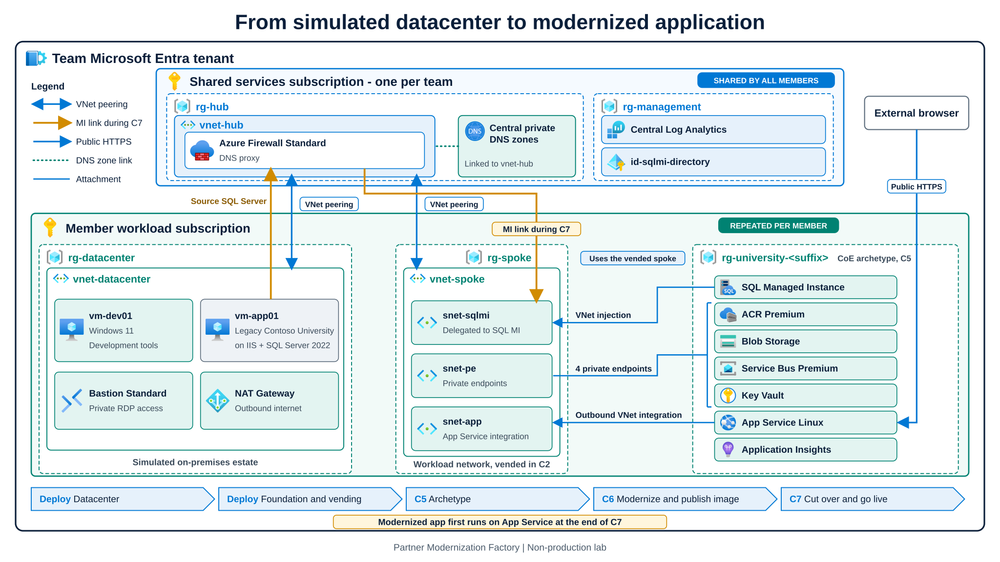

# Partner Modernization Factory hackathon

> **Modernize today. Enable AI tomorrow.**

A two-day, challenge-based hackathon kit for Microsoft partners. A team of up to five builds a secure Azure landing zone, deploys a CoE archetype with [APEX](https://apexops.pro/), modernizes a legacy .NET app with GitHub Copilot, migrates its database to SQL Managed Instance with Azure Arc, and tunes it. They leave with assets they can reuse in customer delivery.

**Start here:** [factory.apexops.pro](https://factory.apexops.pro/), the student site. It has the requirements, the deployment guide, ten challenges and the reference pages.

*What the kit builds, from the simulated datacenter to the modernized app. Select the image to open it full size.*

## The story

Contoso University is a fictional public university. Its student enrollment app runs on .NET Framework 4.8 and IIS on a Windows VM that a small IT team patches by hand. An audit flagged the platform and the way the app stores its database password, and the registrar wants analytics the old stack cannot give safely. Your team is the delivery team of the partner the university hired. It leaves with a modernized app, evidence for six business outcomes and a pattern the university can repeat. [The customer story](site/src/content/docs/getting-started/customer-story.md) has the full page.

## How it works

- **Everyone creates their own repo** from the [`apex-accelerator`](https://github.com/jonathan-vella/apex-accelerator) template and imports this kit into `factory/` with `scripts/Import-Kit.ps1`. There is no shared team repo.
- **Deployment is GitHub Actions only.** Each member deploys their own simulated datacenter in Step 3. The team lead, a colleague the team nominates and the team's first point of contact, deploys the shared foundation in Step 2 and connects every ready member in Step 4 (`vending` checks each member's datacenter and Arc status automatically). The kit's PowerShell scripts are the engine the pipeline runs; a coach can run one by hand to repair a run.
- **The challenges are C1 to C10.** Each page has five parts: Background, Challenge, Requirements, Success criteria and References. The scoring is 170 base points (45 team and 125 member) over 750 minutes, with a maximum score of 200 including bonuses.
- **Students modernize the app themselves** with GitHub Copilot. The kit never changes Contoso University's code.

## What is in the repo

| Folder | What it holds |
| --- | --- |
| `site/` | The student and coach site (Astro and Starlight), published at factory.apexops.pro |
| `coach/`, `facilitator/` | Answer keys, the readiness gate, the agenda, scoring and the run of show |
| `scripts/` | The scripts the pipeline runs, and the content and link checks |
| `infra/` | Bicep for the datacenter, the ALZ-lite foundation and vending |
| `archetype/` | The CoE archetype: the Bicep template and the APEX outputs |
| `app/`, `db/` | The legacy Contoso University app and the database performance kit |
| `templates/` | Evidence templates students copy |
| `.github/` | The platform workflow, the modernization playbook and skills, and CI |
| `docs/` | Diagram sources, the challenge page template, and `docs/archive/` |
| `test/` | Tests that run without Azure |

The PRD, roadmap, backlog and research from building the kit are kept in [docs/archive](docs/archive/README.md).

## Contributing

Read [AGENTS.md](AGENTS.md) first: it has the fixed event order and the rules for scripts, workflows and PRs. Then run `npm ci` once and `npm run check` before you open a PR. To write or change a challenge page, start from [docs/challenge-template.md](docs/challenge-template.md).

## License

[MIT](LICENSE). Third-party material is listed in [NOTICE](NOTICE).
