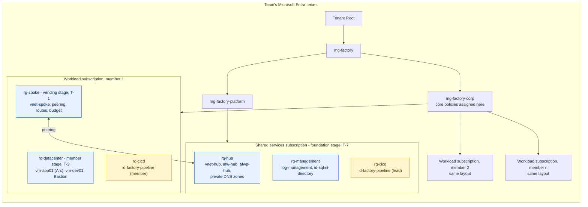
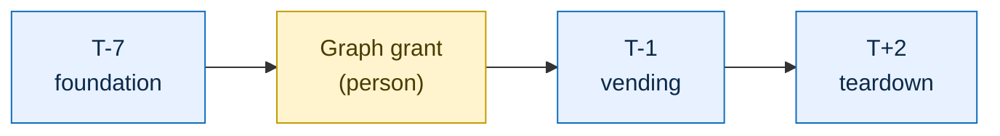
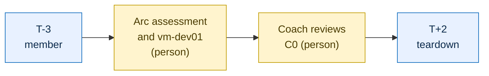
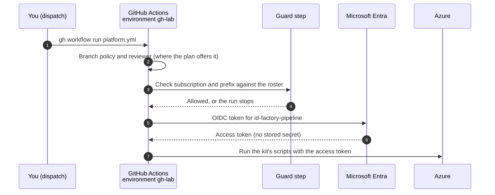

import { Steps } from "@astrojs/starlight/components";
import ArchitectureDiagram from "../../../components/ArchitectureDiagram.astro";

GitHub Actions is how you deploy the kit. You set it up once, run a stage and walk away. Each stage runs the kit's scripts for you.

**Pick your section.**

- **[Member](#member):** everyone, the platform lead included. You deploy your own datacenter at T-3.
- **[Platform lead](#platform-lead):** you also deploy the team's foundation at T-7 and connect every member at T-1.

**You need** the [prerequisites](../../getting-started/prerequisites/) done: your repo with the kit merged to `main`, your settings file, and `az login` and `gh auth login` in the dev container. Run every command from the `factory/` folder.

## Member

About 15 minutes of your time, then 45 minutes unattended.

<Steps>

1. **Set up, once.** It asks nothing: it prints what it will do, creates the pipeline identity and checks the result.

   ```powershell
   ./scripts/Initialize-PlatformPipeline.ps1 -Profile Member
   ```

   On a private repo it may warn that write access is the gate. That is expected.

2. **T-14: run the preflight.** It checks your subscription and fixes what it can.

   ```bash
   gh workflow run platform.yml -f stage=whatif
   ```

   Open the **Actions** tab. Approve the run if GitHub asks. Done when the run is green.

3. **T-3: deploy your datacenter.** Run the preflight again, then the datacenter.

   ```bash
   gh workflow run platform.yml -f stage=whatif
   gh workflow run platform.yml -f stage=member
   ```

   It deploys the datacenter, tests it and connects `vm-app01` to Azure Arc. Done when the run is green.

4. **Save your evidence.** It downloads the test output and also creates your `.local/<subscription-id>/datacenter.json` credentials file. Commit the evidence file as [C0](../../challenges/c00-ready-to-hack/) describes.

   ```powershell
   ./scripts/Get-PipelineEvidence.ps1
   ```

5. **Do what no pipeline can.** Run the Arc assessment in the portal and set up `vm-dev01` (C0 tasks 5 to 7).

</Steps>

Done when `vm-app01` shows as Connected in Azure Arc and `evidence/c00/test-datacenter.txt` is in your repo.

**No Windows Server licenses?** If you don't hold eligible Windows Server licenses, run the member stage with the `no-hybrid-benefit` input. It deploys and tests `vm-app01` without Azure Hybrid Benefit. See [Azure Hybrid Benefit](../../reference/azure-hybrid-benefit/).

```bash
gh workflow run platform.yml -f stage=member -f no-hybrid-benefit=true
```

<details>
<summary>Why it works this way</summary>

- The first time, the preflight registers the Azure providers and the public IP feature on a new subscription. That can take a few minutes.
- The `member` stage never redeploys a datacenter that is already Arc-enabled, because Arc can't be undone.
- Check your setup any time with `./scripts/Test-PipelineSetup.ps1 -PipelineProfile Member`.

</details>

## Platform lead

You do the member steps above for your own datacenter, plus these.

<Steps>

1. **Get the roster.** The event owner gives you a JSON file with one row per member, you included. Save it as `factory/.local/roster.json`, which stays out of git.

   ```json
   [
     { "index": 1, "subscriptionId": "<workload-subscription-id>", "memberPrincipalId": "<entra-object-id>", "budgetEmail": "<email>" }
   ]
   ```

2. **Set up, once.** Use the lead profile with the roster.

   ```powershell
   ./scripts/Initialize-PlatformPipeline.ps1 -RosterPath .local/roster.json
   ```

   To add or change a member later, edit the file and run this again.

3. **T-7: deploy the foundation.** The `whatif` stage also runs the preflight for every member, so a missing role or quota shows up now. The foundation takes 15 to 25 minutes.

   ```bash
   gh workflow run platform.yml -f stage=whatif
   gh workflow run platform.yml -f stage=foundation
   ```

4. **T-7: ask for the Graph grant.** A Privileged Role Administrator runs `Grant-SqlMiDirectoryRead.ps1` once for the team. No pipeline does this, and it must happen before C7. Send them the steps below.

5. **T-3: do your own C0.** Use your own member index, the one the event owner gave you.

   ```bash
   gh workflow run platform.yml -f stage=member -f members=<your-member-index>
   ```

6. **T-1: connect every member.** Wait until every member's datacenter exists and a coach has reviewed their C0. One approval covers the whole stage.

   ```bash
   gh workflow run platform.yml -f stage=vending
   ```

   Plan on about an hour for three members and about 75 minutes for five. Done when the run is green.

7. **Save the C2 evidence.** Copy the run summaries of the `foundation` and `vending` stages. The pipeline already redacts IDs: they show as `<id:abcd>`.

</Steps>

<details>
<summary>What to send the Privileged Role Administrator</summary>

They don't need your repo. They download the single file `https://raw.githubusercontent.com/jonathan-vella/apex-factory-hackathon/main/scripts/Grant-SqlMiDirectoryRead.ps1`, which has no other kit dependencies. They need PowerShell 7, the Azure CLI and Reader on the shared services subscription, and they run it from their own computer, signed in as themselves. See [ALZ-lite](../alz-lite/) and [C2](../../challenges/c02-secure-ai-ready-foundation/#before-the-event).

</details>

<details>
<summary>Why it works this way</summary>

- The pipeline reads its members only from the roster, which setup stores as an environment secret. It never discovers members in Azure, and the guard accepts only those subscriptions.
- Members are connected one after another, because each run updates the shared firewall policy (4 to 5 minutes each). Then every VM restarts at once (about 25 minutes, the SQL VM is the slow one), and the policy scan and connectivity probes run in parallel.
- A member who is already connected is quick on a re-run. If one member fails, fix the cause and run `gh workflow run platform.yml -f stage=vending -f members=<n>` for that member only.

</details>

## If something breaks

Read the run's log, fix the cause and run the stage again: the stages are safe to repeat. After two attempts, ask your coach. [Troubleshooting](../../reference/troubleshooting/#platform-pipeline) lists the common errors.

## Taking it down

After the event, run the `teardown` stage, then remove the pipeline identity.

```bash
gh workflow run platform.yml -f stage=teardown
```

A member's run removes that member's datacenter, spoke and archetype. A lead's run removes every member first, then the team's foundation and management groups. Tick `include-management` only for a lab you are retiring completely: it also deletes `rg-management` and `id-sqlmi-directory`, so a later event needs the Graph grant again.

:::caution
After C5, the member `teardown` stage removes the archetype, including the SQL Managed Instance, which takes hours to provision again. Never run it, or `teardown` followed by a new `member` run, after C5 without asking your coach first.
:::

The workflow can't remove its own identity. When it ends, run this yourself as an admin. It removes the identity's roles, the identity, `rg-cicd`, the GitHub environment and the pipeline's repository variables, then checks each is gone.

```powershell
./scripts/Remove-PlatformPipeline.ps1                    # lead
./scripts/Remove-PlatformPipeline.ps1 -Profile Member    # member
```

## How it works

You don't need this section to deploy. Read it to understand what the stages build and why the pipeline is safe to run.

### What gets deployed

A team has one shared services subscription and one workload subscription per member. Each stage builds one layer.



The member stage builds the datacenter:

<ArchitectureDiagram highlight="c0" name="actions-c0" caption="The member stage builds the datacenter: vm-app01 (the legacy app, Arc-connected) and vm-dev01 (your workstation) behind Bastion." />

The foundation and vending stages build the hub and each member's spoke:

<ArchitectureDiagram highlight="c2" name="actions-c2" caption="The foundation stage builds the hub. The vending stage builds each member's spoke and connects it to the hub." />

The CoE archetype (C5) and the modernized app (C6 and C7) deploy into each member's spoke later, with `azd` and a container image. They are not part of the pipeline. The [end state](../../getting-started/kit-at-a-glance/#the-end-state) shows all of it.

### When and who

The order is fixed by the event. Follow the [event overview](../../getting-started/event-overview/), not the order of the stages in the workflow.





The top row is the platform lead. The bottom row is each member, lead included. Blue steps are Actions stages. Yellow steps are people, because no pipeline can do them.

| Stage | Profile | When | What it does | Time |
| --- | --- | --- | --- | --- |
| `whatif` | Member | T-14, and again at T-3 | Runs the preflight. On a new subscription it also registers the Azure providers and the public IP feature. | a few minutes |
| `whatif` | Lead | T-7 | A read-only what-if of ALZ-lite, and the preflight for every member in the roster. | 3 min, plus a few minutes per member |
| `member` | Member | T-3 | Deploys the datacenter, runs `Test-Datacenter`, and only if that passes onboards `vm-app01` to Azure Arc. | 35 to 45 min |
| `foundation` | Lead | T-7 | Deploys ALZ-lite for the team: management groups, hub, policies. | 15 to 25 min |
| `vending` | Lead | T-1 | Connects each member's subscription to the hub, restarts every VM, records policy exemptions and runs the connectivity probes. | about 1 hour for 3 members |
| `teardown` | Both | T+2 | Removes what the other stages built. | about 20 min, then about 25 for the team |

Run `all` only in a test lab. It runs `whatif`, `foundation`, `member` and `vending` in the event order, but in one go, so it skips the coach's C0 review that vending waits for at an event.

### What setup grants, and why

Setup creates a managed identity called `id-factory-pipeline` in a resource group called `rg-cicd`. GitHub proves who it is with a short-lived OIDC token, so there is no password or secret to leak. The identity is trusted only for one GitHub environment, `gh-lab`, in one repo.



- **Member profile:** Owner on your own workload subscription. Nothing else.
- **Lead profile:** Owner at Tenant Root, so it can create the kit's management groups and move subscriptions (in a test lab, at a sandbox management group instead).

Why Owner: the kit assigns roles and policies, which Contributor can't do. The risk is real: anyone who can run a workflow in the environment can use that identity. Three guards limit it. The environment accepts only the branches you list. A required reviewer approves each run where your GitHub plan offers it (on a private repo without that feature, write access to the repo is the gate, so keep the repo private and the writers few). And the guard step refuses any subscription that isn't on its approved list. Use only a non-production tenant. The event owner and coaches have recorded this as an accepted risk.

Subscription IDs and your roster are stored as environment secrets, never in the repo or its logs. A repo has exactly one profile: the platform lead sets up the lead profile in the lead's repo and doesn't run the member profile there.
