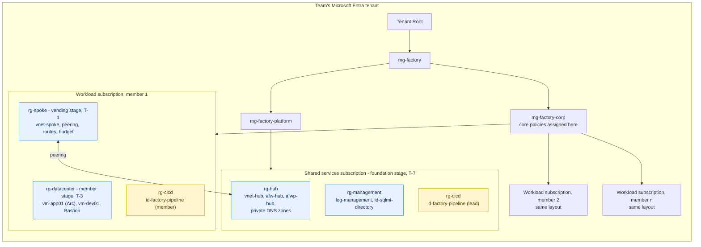
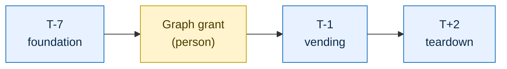
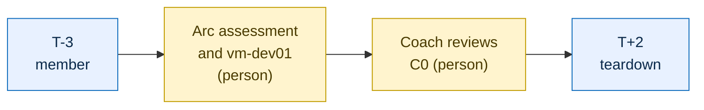
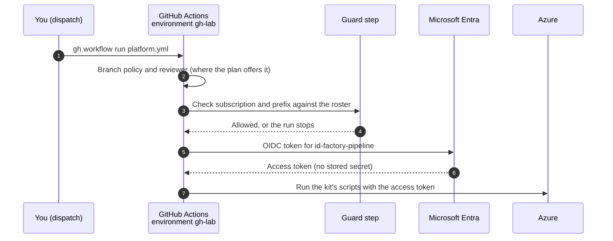

import ArchitectureDiagram from "../../../components/ArchitectureDiagram.astro";

GitHub Actions is the preferred way to deploy the kit. You set it up once, then run a stage and walk away: no terminal to babysit for 45 minutes, and every run leaves a log. The Actions run the same scripts you would run yourself, so the result is identical. If you can't use Actions, or something breaks, [deploy with scripts](../deploy-with-scripts/) instead. Both paths give the same result, and the scripts stay a supported path.

You read one section of this page: **Member** if you deploy a datacenter, **Platform lead** if you also deploy the foundation. The platform lead is also a member, so the lead reads both.

## What gets deployed

Each stage builds one layer of the same picture. A team has one shared services subscription and one workload subscription per member.



The CoE archetype (C5) and the modernized app (C6 and C7) deploy into each member's spoke later, with `azd` and a container image. They are not part of the pipeline. The [end state](../../getting-started/kit-at-a-glance/#the-end-state) shows all of it.

## When and who

The order is fixed by the event. Follow the [event overview](../../getting-started/event-overview/), not the order of the stages in the workflow.





The top row is the platform lead (stages `whatif` then `foundation`, then `vending`). The bottom row is each member, lead included (stages `whatif` at T-14 and again at T-3, then `member`). Blue steps are Actions stages. Yellow steps are people, because no pipeline can do them. Each role sets up its profile once first. A member's vending waits for the coach's C0 review. The platform lead's own C0 runs in the lead's repo with `-f stage=member -f members=<your-member-index>`.

| Stage | Profile | When | What it does | Time |
| --- | --- | --- | --- | --- |
| `whatif` | Member | T-14, and again at T-3 | Runs the preflight. On a new subscription it also registers the Azure providers and the public IP feature. | a few minutes |
| `whatif` | Lead | T-7 | A read-only what-if of ALZ-lite. It also runs the preflight for every member in the roster. | 3 min, plus a few minutes per member |
| `member` | Member | T-3 | Deploys the datacenter, runs `Test-Datacenter`, and only if that passes onboards `vm-app01` to Azure Arc. | 35 to 45 min |
| `foundation` | Lead | T-7 | Deploys ALZ-lite for the team: management groups, hub, policies. | 15 to 25 min |
| `vending` | Lead | T-1 | Connects each member's subscription to the hub, then restarts every VM at once, records policy exemptions and runs the connectivity probes. | about 1 hour for 3 members |
| `teardown` | Both | T+2 | Removes what the other stages built. | about 20 min, then about 25 for the team |

Run `all` only in a test lab. It runs `whatif`, `foundation`, `member` and `vending` in the event order, but in one go, so it skips the coach's C0 review that vending waits for at an event.

## Before you start

You have finished the [prerequisites](../../getting-started/prerequisites/): your own repo with the kit imported and merged to `main`, and `factory/.local/settings.json`. Run everything below from `factory/` in the dev container, signed in with `az login` and `gh auth login`. GitHub runs a workflow only from the default branch, so the import must be on `main`.

### What setup grants, and why

Setup creates a managed identity called `id-factory-pipeline` in a resource group called `rg-cicd`. GitHub proves who it is with a short-lived OIDC token, so there is no password or secret to leak. The identity is trusted only for one GitHub environment, `gh-lab`, in one repo.



- **Member profile:** Owner on your own workload subscription. Nothing else.
- **Lead profile:** Owner at Tenant Root, so it can create the kit's management groups and move subscriptions (in a test lab, at a sandbox management group instead).

Why Owner: the kit assigns roles and policies, which Contributor can't do. The risk is real, so know it: anyone who can run a workflow in the environment can use that identity. Three guards limit it. The environment accepts only the branches you list. A required reviewer approves each run where your GitHub plan offers it (on a private repo without that feature, write access to the repo is the gate, so keep the repo private and the writers few). And the guard step refuses any subscription that isn't on its approved list. Use only a non-production tenant. The event owner and coaches have recorded this as an accepted risk.

Subscription IDs and your roster are stored as environment secrets, never in the repo or its logs.

A repo has exactly one profile. The platform lead sets up the lead profile in the lead's repo and doesn't run the member profile there.

## Member

Run the preflight (`whatif`) at T-14, and run it again with the datacenter at T-3. The datacenter takes about 45 minutes, unattended.

<ArchitectureDiagram highlight="c0" name="actions-c0" caption="The member stage builds the datacenter: vm-app01 (the legacy app, Arc-connected) and vm-dev01 (your workstation) behind Bastion." />

1. Set up the member pipeline once. It asks for nothing: it prints a plan, creates the identity and the `gh-lab` environment, sets the secrets and checks the result.

   ```powershell
   ./scripts/Initialize-PlatformPipeline.ps1 -Profile Member
   ```

   On a private repo with no reviewer option it warns that write access is the gate. That is expected.

2. At T-14, run the preflight:

   ```bash
   gh workflow run platform.yml -f stage=whatif
   ```

   At T-3, run it again, then the datacenter:

   ```bash
   gh workflow run platform.yml -f stage=whatif
   gh workflow run platform.yml -f stage=member
   ```

   Approve the run in the **Actions** tab if GitHub asks. The `member` stage runs the preflight first, deploys the datacenter, runs `Test-Datacenter` and, only if that passes, onboards `vm-app01` to Azure Arc. It never redeploys a datacenter that is already Arc-enabled, because Arc can't be undone.

3. Download your C0 evidence and commit it as [C0](../../challenges/c00-ready-to-hack/) describes:

   ```powershell
   ./scripts/Get-PipelineEvidence.ps1
   ```

   That saves `evidence/c00/test-datacenter.txt`.

4. Do the steps no pipeline does: the Arc migration assessment in the portal and the `vm-dev01` setup (C0 tasks 5 to 7).

**If you deploy with Actions:**

- The runner deploys the datacenter, so `.local/<subscription-id>/datacenter.json` doesn't exist in your dev container. Where a page tells you to read a password from that file, use the documented lab credentials instead: user `labadmin` with the lab password `FactoryLab-2026-Pw`, and the same password for the SQL login `contosoapp`. This is a documented exception for the throwaway datacenter only (see the [datacenter README](https://github.com/jonathan-vella/apex-factory-hackathon/blob/main/infra/datacenter/README.md)). Don't reuse it anywhere else.
- The Actions stages can't pass `-NoHybridBenefit`. If you don't hold eligible Windows Server licenses, deploy the datacenter with [scripts](../deploy-with-scripts/#member) instead (see [Azure Hybrid Benefit](../../reference/azure-hybrid-benefit/)).

Check the setup any time with `./scripts/Test-PipelineSetup.ps1 -PipelineProfile Member`.

## Platform lead

You need your repo with the kit imported, `factory/.local/settings.json` including your shared services subscription, and the roster file from the event owner.

<ArchitectureDiagram highlight="c2" name="actions-c2" caption="The foundation stage builds the hub. The vending stage builds each member's spoke and connects it to the hub." />

1. Set up the lead pipeline once, with the roster:

   ```powershell
   ./scripts/Initialize-PlatformPipeline.ps1 -RosterPath <roster file>
   ```

   The roster is a JSON file the event owner gives you (or you write from the event owner's list), kept in `factory/.local/roster.json` so it stays out of git. It holds one row per member, you included:

   ```json
   [
     { "index": 1, "subscriptionId": "<workload-subscription-id>", "memberPrincipalId": "<entra-object-id>", "budgetEmail": "<email>" },
     { "index": 2, "subscriptionId": "<workload-subscription-id>", "memberPrincipalId": "<entra-object-id>", "budgetEmail": "<email>" }
   ]
   ```

   Setup stores it as an environment secret. The pipeline reads its members only from there: it never discovers them in Azure, and the guard accepts only these subscriptions. To add or change a member, edit the file and run the setup again.

2. At T-7, deploy the foundation. The `whatif` stage also runs the preflight for every member in the roster, so a missing role or quota shows up before you deploy:

   ```bash
   gh workflow run platform.yml -f stage=whatif
   gh workflow run platform.yml -f stage=foundation
   ```

3. Ask a Privileged Role Administrator to run `Grant-SqlMiDirectoryRead.ps1` once for the team. No pipeline does this, and it must happen before C7. They don't need your repo: they download the single file `https://raw.githubusercontent.com/jonathan-vella/apex-factory-hackathon/main/scripts/Grant-SqlMiDirectoryRead.ps1`, which has no other kit dependencies, and need PowerShell 7, the Azure CLI and Reader on the shared services subscription. See [ALZ-lite](../alz-lite/) and [C2](../../challenges/c02-secure-ai-ready-foundation/#before-the-event).

4. Run your own C0 with the member stage for your own member index (the one the event owner assigned you):

   ```bash
   gh workflow run platform.yml -f stage=member -f members=<your-member-index>
   ```

5. At T-1, once every member's datacenter exists and a coach has reviewed their C0:

   ```bash
   gh workflow run platform.yml -f stage=vending
   ```

   One approval covers the stage. Members are vended strictly one after another, because each run updates the shared firewall policy (4 to 5 minutes each). Then every VM restarts at once, with one wait of about 25 minutes (the SQL VM is the slow one), and the policy scan and the connectivity probes run for everyone in parallel. Plan on about an hour for three members and about 75 minutes for five.

   For C2, copy the run summaries (or logs) of the `foundation` and `vending` stages, with IDs redacted, as your `Deploy-AlzLite.ps1` and `Deploy-Vending.ps1` evidence. `Get-PipelineEvidence.ps1` downloads only C0's `test-datacenter.txt`.

   A member already vended is quick on a re-run. If one member fails, fix the cause and run `-f stage=vending -f members=<n>` for that member only.

## If something breaks

Read the run's log, fix the cause and run the stage again: the scripts are idempotent. After two attempts, ask your coach. [Troubleshooting](../../reference/troubleshooting/#platform-pipeline) has the specific errors. Every stage is also a kit script you can run yourself: see [deploy with scripts](../deploy-with-scripts/).

## Taking it down

Both profiles have a `teardown` stage and a cleanup script for the identity, so nothing billable or privileged is left behind.

```bash
gh workflow run platform.yml -f stage=teardown
```

A member's run removes that member's datacenter, spoke and archetype. A lead's run removes every member first, then the team's foundation and management groups, and returns the subscriptions to the parent group. Tick `include-management` only for a lab you are retiring completely: it also deletes `rg-management` and `id-sqlmi-directory`, so a later event needs the Graph grant again.

:::caution
After C5, the member teardown removes the archetype, including the SQL Managed Instance, which takes hours to provision again. Never run it, or a teardown followed by a new `member` run, after C5 without asking your coach first.
:::

The workflow can't remove its own identity. When it ends, run the identity cleanup script yourself as an admin:

```powershell
./scripts/Remove-PlatformPipeline.ps1                    # lead
./scripts/Remove-PlatformPipeline.ps1 -Profile Member    # member
```

It removes the identity's roles, the identity, `rg-cicd`, the GitHub environment and the pipeline's repository variables, then checks that each is gone.
