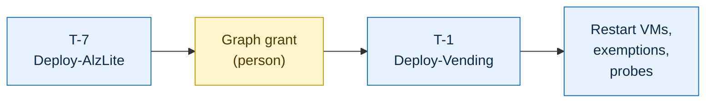
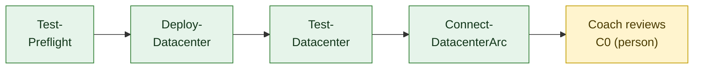

import ArchitectureDiagram from "../../../components/ArchitectureDiagram.astro";

This page is the manual path. The kit's scripts are the supported way to deploy, and the [GitHub Actions path](../deploy-with-actions/) runs these same scripts for you. Use the scripts when Actions isn't available to you, when you want to see each step, or when an Actions run failed and you want to repair it. Both paths give the same result, so you can switch between them for different stages.

You read one section: **Member** if you deploy a datacenter, **Platform lead** if you also deploy the foundation. The platform lead is also a member, so the lead reads both. [C0](../../challenges/c00-ready-to-hack/) and [C2](../../challenges/c02-secure-ai-ready-foundation/) have the full tasks, the done checks and the hints. This page is the short sequence.

Run every command from `factory/` in the dev container, signed in with `az login`. In each new terminal, load your settings first:

```powershell
$s = Get-Content .local/settings.json | ConvertFrom-Json
```

## The order matters





The top row is the platform lead's (blue). The bottom row is each member's, lead included (green). Yellow steps are people. Vending needs both ALZ-lite and the member's reviewed C0.

- Run `Test-Datacenter.ps1` **before** Arc: Arc turns off the guest agent the test relies on.
- Never redeploy a datacenter after Arc, and never run the Arc script a second time.
- ALZ-lite and each member's datacenter must exist before vending. The Graph grant comes after ALZ-lite and before C7.

## Member

Run this at T-3. The deploy takes up to 60 minutes, unattended. Keep the terminal open and your computer awake.

<ArchitectureDiagram highlight="c0" name="scripts-c0" caption="The datacenter: vm-app01 (the legacy app, later Arc-connected) and vm-dev01 (your workstation) behind Bastion." />

1. Check your subscription (T-14). Fix every FAIL, then re-run with `-Fix` to register providers:

   ```powershell
   ./scripts/Test-Preflight.ps1 -WorkloadSubscriptionId $s.subscriptionId -Location $s.location -OutFile .local/preflight.json
   ```

2. Deploy the datacenter. It is safe to run again until Arc onboarding:

   ```powershell
   ./scripts/Deploy-Datacenter.ps1 -SubscriptionId $s.subscriptionId -MemberIndex $s.memberIndex -Location $s.location
   ```

3. Confirm it is healthy. Every row must be PASS. Save the output as your evidence:

   ```powershell
   ./scripts/Test-Datacenter.ps1 -SubscriptionId $s.subscriptionId -MemberIndex $s.memberIndex
   ```

4. Onboard `vm-app01` to Azure Arc. Don't run it again if it times out after it started:

   ```powershell
   ./scripts/Connect-DatacenterArc.ps1 -SubscriptionId $s.subscriptionId -MemberIndex $s.memberIndex -Location $s.location
   ```

5. Do the steps only a person can: the Arc migration assessment in the portal and the `vm-dev01` setup (C0 tasks 5 to 7).

## Platform lead

You need Owner at Tenant Root, your shared services subscription in `.local/settings.json`, and the values the event owner captured for every member.

<ArchitectureDiagram highlight="c2" name="scripts-c2" caption="Deploy-AlzLite builds the hub. Deploy-Vending builds each member's spoke and connects it to the hub." />

1. At T-7, deploy the foundation. It takes about 15 to 25 minutes, mostly Azure Firewall, and bills about $1.30 an hour until the event is cleaned up:

   ```powershell
   az account set --subscription $s.sharedSubscriptionId
   ./scripts/Deploy-AlzLite.ps1 -SharedSubscriptionId $s.sharedSubscriptionId -Location $s.location -WhatIf
   ./scripts/Deploy-AlzLite.ps1 -SharedSubscriptionId $s.sharedSubscriptionId -Location $s.location
   ```

2. Right after it, a Privileged Role Administrator grants the SQL MI identity its Graph read, once per team, from their own computer and signed in as themselves (see [ALZ-lite](../alz-lite/)):

   ```powershell
   ./scripts/Grant-SqlMiDirectoryRead.ps1 -SharedSubscriptionId '<shared-services-subscription-id>'
   ```

3. Do your own C0 as a member, above.

4. At T-1, vend each member one after another, after a coach has reviewed their C0. Each run updates the same firewall policy, and takes about 4 minutes:

   ```powershell
   ./scripts/Deploy-Vending.ps1 -WorkloadSubscriptionId '<member-subscription-id>' -SharedSubscriptionId $s.sharedSubscriptionId -MemberIndex <member-index> -MemberPrincipalId '<member-object-id>' -BudgetEmail '<member-email>' -Location $s.location
   ```

5. For every member, restart both VMs, record the exemptions, then run the probes. Tell the member first: a restart ends their Bastion session.

   ```powershell
   az vm restart -g rg-datacenter -n vm-dev01 --subscription '<member-subscription-id>'
   az vm restart -g rg-datacenter -n vm-app01 --subscription '<member-subscription-id>'
   ./scripts/New-DatacenterExemptions.ps1 -SubscriptionId '<member-subscription-id>' -Owner '<member name>'
   ./scripts/Test-Connectivity.ps1 -SubscriptionId '<member-subscription-id>' -SharedSubscriptionId $s.sharedSubscriptionId -MemberIndex <member-index>
   ```

   If the exemptions output says "nothing to do", the policies haven't taken effect yet (up to 30 minutes after ALZ-lite). Wait and run it again.

Never commit the member values (subscription ID, object ID, email) to any repo. The [C2 page](../../challenges/c02-secure-ai-ready-foundation/#before-the-event) lists them with where each comes from.

## If something breaks

The scripts are idempotent. Run the same command again to converge a failed or partial deployment. There is no `-Force` parameter. After two attempts, ask your coach. [Troubleshooting](../../reference/troubleshooting/) has the specific errors. If a member's datacenter is redeployed before Arc, the lead vends that member again, restarts both VMs and records the exemptions again.

## Taking it down

Follow [cleanup](https://github.com/jonathan-vella/apex-factory-hackathon/blob/main/facilitator/cleanup.md): `Remove-FactoryEnvironment.ps1` for every member scope first, then the team scope. To stop the firewall's cost without a full removal, delete `rg-hub` in the shared services subscription.
